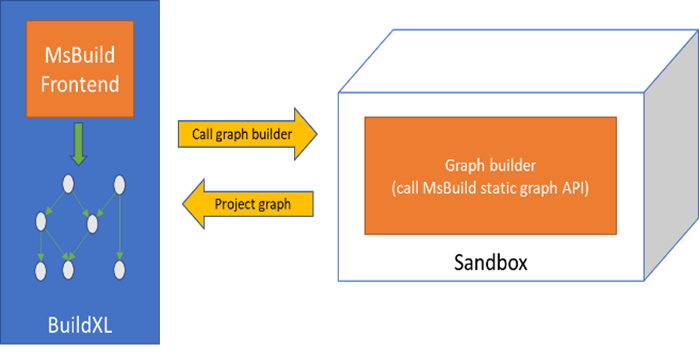

# Working with the MSBuild resolver

The MSBuild resolver is a supported BuildXL frontend for building MSBuild-based repositories. It uses the MSBuild static graph API
to create a project graph that BuildXL translates into a pip graph. Each pip executes MSBuild on a project instance, and the execution
result is assigned a symbol that other frontends can reference. For example, a process declared in a DScript frontend can consume
the execution result of an MSBuild project instance.

The MSBuild resolver is supported on Windows and Linux. It is currently unavailable on macOS.

## The basics

Building a MSBuild-based repository using BuildXL is typically as simple as adding a MSBuild resolver (a frontend instance) 
in the BuildXL configuration file, `config.dsc`, that specifies where to find the entry point of the build, and this entry point can
be the root of the repository:
```typescript
config({
    resolvers: [
        {
            kind: "MsBuild",
            root: d`.`,
            moduleName: "HelloWorld",
        }
    ]
});
```
The `kind` property specifies that the resolver is a MSBuild resolver. The root of the MSBuild build is specified as 
the directory where `config.dsc` is located. BuildXL will try to find files in that directory whose extension ending
with `proj` or `sln`. The MSBuild portion built by the resolver
is considered as a single BuildXL module, and the `moduleName` property specifies the module name.

Each project file in the MSBuild build is assigned a symbol that can be referred by other frontends. The symbol denotes
the execution result of all project instances of the project file. This symbol resembles the relative path of the project
file from the root. For example, if the build has a project file `source\dev\Foo.Bar.csproj`, then a DScript project (specified)
in a DScript resolver can consume the execution result of that project by referring to its symbol:
```typescript
const x = importFrom("HelloWorld").source_dev_Foo_Bar;
```
For details on DScript, see [DScript](../DScript/Main.md).

## More resolver settings

The MSBuild resolver has plenty of settings. In what follows, we will explain some of them that are commonly used. The complete settings
can be found at [Prelude.Configuration.Resolvers.dsc](../../../../Public/Sdk/Public/Prelude/Prelude.Configuration.Resolvers.dsc).

*msBuildSearchLocations*. This property specifies the directories to search for MSBuild toolset. When not specified, the location
is determined using [Microsoft build locator](https://github.com/Microsoft/MSBuildLocator).

*msBuildRuntime*. This property selects the MSBuild runtime: `"FullFramework"` for .NET Framework MSBuild or
`"DotNetCore"` for MSBuild shipped with a .NET SDK.

*fileNameEntryPoints*. This property specifies the relative paths from the root to the projects or solutions to start parsing the MSBuild repository.

*initialTargets*. This property specifies targets to execute on the entry point project. If not provided, the default targets are used.

*environment*. This property specifies the environment variables available for building all projects. 
If it is undefined, then the current process' environment is made available for building all projects.
It is always advised to explicitly specify these environment variables to avoid cache misses due to churn of environment variable values.

*globalProperties*. Similar to building with MSBuild, the MSBuild frontend of BuildXL allows for specifying additional global properties.

*logVerbosity*. This option controls the logging verbosity of MSBuild. It is an enum that has the same set of values as the ones offered by MSBuild.

*enableBinLogTracing*. This option enables binlog tracing in MSBuild, and the `msbuild.binlog` file is going to be placed in the log directory.

*enableAzureDevOpsTestResultsPublishing*. Defaults to `false`. Set to `true` to forward `##vso[results.publish ...]` commands
from project output to the executing machine's console, including on distributed workers. Only indentation or an MSBuild numeric
prefix (such as `1>` or `1:2>`) may precede the command. The test target must create the result files and emit the command, and an
Azure Pipelines agent on that machine must capture the console output. Other Azure DevOps commands are not forwarded.
This option affects the process fingerprint. Publishing commands are not replayed on cache hits.

*enableTransitiveProjectReferences*. This option allows projects to access the transitive closure of its references. Enabling this option
can affect build performance, particularly in distributed builds where all possible inputs must be available before a project is
executed. Some MSBuild repositories rely on this behavior.

*useLegacyProjectIsolation*. When enabled, MSBuild builds each project in legacy mode, relying on SDK conventions to respect project
boundaries and avoid building dependencies. To avoid overbuilds, BuildXL merges inner and outer projects when using legacy project
isolation. See [ProjectInterpretation.cs](https://github.com/dotnet/msbuild/blob/main/src/Build/Graph/ProjectInterpretation.cs)
for more details.

*allowProjectsToNotSpecifyTargetProtocol*. This option allows projects to not specify their target protocol. In such a case default targets will be
used as heuristics.

A more complete example of a MSBuild resolver is as follows:

```typescript
config({
    resolvers: [
        {
            kind: "MsBuild",
            root: d`.`,
            fileNameEntryPoints: [r`HelloWorld.csproj`],
            moduleName: "HelloWorld",
            environment: Map.empty<string, string>().addRange(
                ["Env1", "Val1"],
                ["Env2", "Val2"])
            globalProperties: Map.empty<string, string>().addRange(
                ["Configuration", "Release"],
                ["Platform",      "x64"]),
            logVerbosity: "minimal",
            enableBinLogTracing: true
        },
    ]
)
```

## Design and implementation

The MSBuild frontend relies on the [MSBuild static graph API](https://github.com/dotnet/msbuild/blob/main/documentation/specs/static-graph.md)
to create a project graph. During the [graph construction phase](../../CoreConcepts.md), BuildXL launches a graph-builder tool to
build the MSBuild project graph, as shown below:



The graph-builder tool runs in a sandbox so BuildXL can monitor file accesses and use them for caching. BuildXL does not need to
reconstruct the MSBuild graph when nothing has changed. After graph construction, BuildXL translates the project graph into a pip
graph whose pips execute in dependency order during the [execution phase](../../CoreConcepts.md).

## Examples

- [Building a simple Hello World C# project](./Walkthrough-Building-CSProj.md)
- [Building a simple Hello World VCX project](./Walkthrough-Building-VCXProj.md)
- [Building a hybrid MSBuild and DScript projects](./Walkthrough-Building-Hybrid.md)
