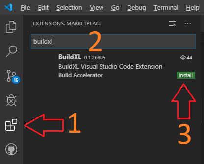

# Installing BuildXL

## Build Engine
Prebuilt binaries for BuildXL are only distributed internally within Microsoft. Externally you'll need to build the project locally from the main branch of its repo. See the [Developer Guide](DeveloperGuide.md) for instructions.

## DScript [Visual Studio Code](https://code.visualstudio.com) Plug-in

### Windows
You can find the plugin in the marketplace under "BuildXL". It should be recommended for our repo.

The steps to take are:

